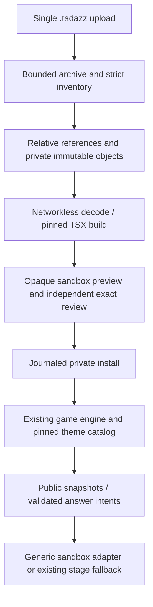

# Portable packages and isolated renderers (ADR 2026-11-09)

Base: `origin/codex/sync-all-20261109`, `a489197`, fetched 9 November.
The old `tadazz-next-20261105` dirty worktree is preserved. Implementation is
in `codex/tadazz-package-runtime-20261109`. The supplied development plan
authorizes this additive feature and isolated Oracle QA, not production or push.

## Decisions and contracts

`.tadazz` is a bounded ZIP with a strict v1 root manifest. Inspect central and
local headers, paths, file types, CRC, declared/actual byte counts and SHA256
before staging. Reject encryption, ZIP64, split archives, links, special files,
duplicates (NFC/case folded), nested archives and unknown inventory entries.
Read compressed entries sequentially with an output limit; never extract paths
supplied by a customer. Packer emits deterministic stored ZIP entries.

Resolve each media reference relative to its declaring JSON/CSS/TSX file, only
at the package boundary. Existing global media URL validators stay strict.
Source and descriptors remain portable. Installed game JSON uses existing media
URLs and existing composite import (fresh quiz/question/timeline identities).

Private metadata and immutable install journals use SQLite. Binary objects live
in a separate tenant-hashed filesystem store, keyed by digest. Installation
stages and validates all contents before creating games; a durable journal
records each created game and compensates interrupted installations on recovery.
No garbage collection of referenced assets or old published versions.

New sandbox families use one generic platform adapter; later uploaded families
need no renderer registration or platform deployment. The existing compiled
Classic/Razzia/declarative path and publication policy remain available. Private
installation is distinct from marketplace publication and never grants platform
publication. Review binds exact source/build digests and independent reviewer.

Build is an operator-run worker, outside the web/game process. A read-only pinned
toolchain, rootless networkless container, unprivileged UID, read-only sources,
bounded tmpfs/CPU/RAM/PIDs/time/output and a finite import resolver are required.
No package scripts/install/SSR are run. The application has no Docker socket.
Only React, React DOM, the versioned SDK and relative package files resolve.

Runtime is a separate origin with no account cookies, `sandbox="allow-scripts"`,
CSP, scoped expiring asset capabilities and no connect/forms/popups/workers.
The bridge authenticates window/source, opaque-origin handshake, channel nonce,
schema, epochs and monotonic sequence. Only explicitly projected public fields
cross it; no arbitrary extras/account/socket/credentials. Intents return through
existing answer handlers. The existing audio owner remains outside the iframe.
Timeout/error/unresponsive renderer falls back without changing authoritative
state. Browser isolation cannot promise a hard CPU/GPU quota.

## Inventory / additive seams (recorded before editing)

Reuse: show themes schemas/registry/resolver/version pins, composite import/export,
existing media validation/authorization, live server snapshots, native controls,
eight locale resource maps and AudioCuePlayer. New: package format/resolver/store,
build worker, sandbox SDK/host, authenticated package API and manager panel.

Essential integration hooks, authorized by the supplied plan:

Follow-up recorded before edit: `configurations/index.tsx` initially selects the
existing Quizz tab only when the authenticated package-preview deep link contains
`packageUpload`. Normal manager entry keeps its existing Play tab. This lets the
CLI open the same real preview and catalog without adding a parallel application.

| Path / symbol                                                   | Need, alternative, regression                                                                                                                                                                                                                                                                        |
| --------------------------------------------------------------- | ---------------------------------------------------------------------------------------------------------------------------------------------------------------------------------------------------------------------------------------------------------------------------------------------------- |
| socket `api/index.ts` routes                                    | Mount authenticated `/packages`; extension-only code cannot mount itself. Installer OFF returns 404.                                                                                                                                                                                                 |
| socket `services/theme-installation.ts` catalog/selection/media | Compose private package definitions with existing immutable catalog, preserve old selections and room pins. No game/timer edits.                                                                                                                                                                     |
| socket `api/extensions/theme-routes.ts` catalog                 | Offer installed private package versions through existing Studio provider. Preserve old installer/review API.                                                                                                                                                                                        |
| web `ConfigManageQuizz`                                         | Mount native package panel and detect `.tadazz` before legacy XLSX; retain legacy import.                                                                                                                                                                                                            |
| web `tadazz-show/show-theme-adapters.ts`                        | Register one generic sandbox adapter/preview, never individual uploaded renderers.                                                                                                                                                                                                                   |
| web `TadazzShowView` stage                                      | Optional sandbox stage content inside existing shell; existing controls, answer/audio ownership stay mounted.                                                                                                                                                                                        |
| web `GameWrapper` cinematicSurface, follow-up before edit       | Live browser proved the existing native operator/player gate never invokes the registered adapter for those roles. Include only an installed runtime pin in the adapter-surface condition; compiled/native roles retain their exact path. Test real host/player/display and legacy/browser controls. |
| socket `services/media-read.ts` allowedMediaName                | Add m4a extension/MIME for packaged audio; leave authorization unchanged. Regression uses allowed/forbidden names and real media requests.                                                                                                                                                           |
| `extensions/package.json`, root lockfile                        | Pin existing toolchain esbuild 0.28.2 as a direct authoring dependency. No runtime/customer dependency installation.                                                                                                                                                                                 |

Do not change scoring, clocks, transports, telephony, common schemas, credentials,
production configuration or existing lab containers. All executable checks run
in a new Oracle container with its own data and no published ports.

## Gates and evidence

Contract/negative ZIP tests → relative-media import/export → declarative install
and version persistence → isolated TSX build and live bridge → complete atomic
install → Chromium/WebKit/security/live regression → authoring docs/CLI → private
staging restart/rollback. Record actual outcomes and remaining gates in
`PACKAGE_RUNTIME_ACCEPTANCE_2026-11-09.md`. Compilation alone is insufficient.

References: [iframe sandbox](https://developer.mozilla.org/en-US/docs/Web/HTML/Reference/Elements/iframe),
[esbuild plugins](https://esbuild.github.io/plugins/),
[upload boundaries](https://cheatsheetseries.owasp.org/cheatsheets/File_Upload_Cheat_Sheet.html).

## Resource and composition tradeoffs

Declarative-preview follow-up recorded before edit: extend the existing
`theme-installation.ts/readThemePreviewMedia` hook to recognize a distinct
package capability prefix. Verify exact tenant/source/build/expiry before
serving decoded preview-ready objects. This reuses the native Classic preview,
including its media URLs, without granting account credentials to preview
content or converting it to an executable sandbox. Test foreign-account denial,
readiness gates and actual browser image decoding.

The parser uses bounded buffers rather than a new streaming ZIP dependency:
180 MB compressed, 250 MB expanded, 100 MB per entry, 2,000 files and expansion
ratio 100. At most two import/preflight bodies are admitted concurrently per
process. Inflation has an explicit maximum output and never writes customer
paths. Large binary objects stay outside SQLite. These explicit budgets should
be lowered for smaller hosts; no claim of unlimited video ingestion is made.

The store intentionally keeps its transaction/journal/review authority in one
cohesive file despite the normal small-module preference. Archive, references,
preflight, game staging, capability serving, decoding and worker execution are
separate modules. Splitting the synchronous commit authority across services
would obscure the recovery invariant. No second game engine is introduced.

Media composition remains owned by the original trusted stage: uploaded TSX
controls its independent visual layout, while original foreground video/Lottie
and AudioCuePlayer preserve timing and autoplay policy. Direct iframe media
playback is blocked; unsupported numeric/question-video slots use the compiled
stage. React style attributes are permitted, while executable script and style
blocks remain hash-bound and network egress stays denied.

