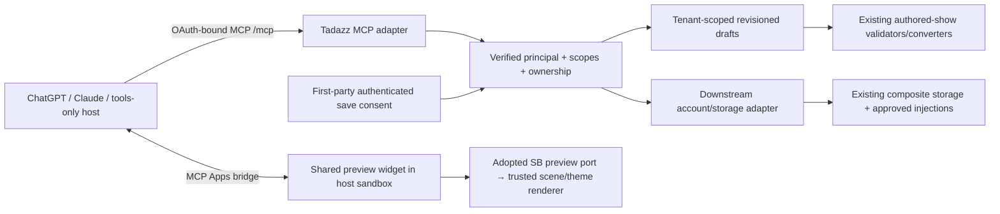

# Tadazz MCP App — architecture decision record

Canonical delivery of the reviewed M1 research. The binding manager decision,
final SB pins, source/live provenance and current implementation gates are in
[MCP_APP_ADOPTION_20261115.md](MCP_APP_ADOPTION_20261115.md), which supersedes
historical candidate-status/interim-SB observations below. The linked security
JSON is a byte-identical snapshot of frozen M1 evidence, including its original
candidate label and NOT_RUN runtime cases; adoption does not turn them into PASS.
No implementation/host result is inferred from research completion. Current M2
work is isolated and unvalidated, with no production mount or source-engine edit.

Design baseline: **0.1.0, ADOPTED DESIGN**, 15 November 2026. Author: mcp_server,
Codex Desktop UUID `01a1dd19-f64c-7193-8a74-9ad7b2c66e2d`.
Reviewer/adopter: manager `01a1dd10-2ef0-73c2-9c65-569a843f44da`;
independent QA reviewer is recorded in the lease. **DESIGN ADOPTED; NOT SHIPPED. Implementation, installation, authenticated account,
platform, security, device and release acceptance remain unproven.**

## Decision and limits

Use one HTTPS remote MCP service, one shared MCP Apps widget, and small
host metadata/installation adapters. Keep authoring, scoring, theme resolution,
scene rendering and audio under the existing Tadazz owners. This ADR defines a
new adapter contract; it does not claim the proposed endpoints/tools already exist.

MVP story: create a five-question authored draft, render a trusted interactive
demo, answer locally, pause/replay/advance, change Q3 conversationally, refresh
the same revisioned draft, then explicitly save a new account game or export.
No room is created. No vote, score, phone call, charge, public publication or
customer theme build is triggered. Future theme creation/update waits for
SB-02/05/06/07 contracts; SB-08 full Theme Builder UI is not an MVP prerequisite.

The two leased deliverables are this file and
[M1_SECURITY_ACCEPTANCE_20261115.json](M1_SECURITY_ACCEPTANCE_20261115.json).
The JSON is the normative proposed MCP envelope/schema and acceptance index.
Its product schemas are input constraints around existing validators, not a
second game format. A breaking envelope/tool change increments the contract
version; breaking widget bytes use a new resource URI.

## Evidence boundary and current source findings

Read-only reference:
`C:/Users/DAVID/Code/Razzia-worktrees/tadazz-design-system-20261110`,
branch `codex/tadazz-design-system-20261110`,
HEAD `8a43c99c65d8923bd23d8c57ac3607e9a09b5764`.
`git status --porcelain` returned empty before contract writing. Local refs
were inspected without checkout/fetch; they are cached local evidence only.
Remote branch freshness and deployed SHA remain unverified. A public
`https://tadazz.com` fetch failed in the web tool; no authenticated production
access or live correctness claim follows.

| Source at this HEAD                                                            | Observed behavior                                                                                            | Required downstream decision                                                                                                                           |
| ------------------------------------------------------------------------------ | ------------------------------------------------------------------------------------------------------------ | ------------------------------------------------------------------------------------------------------------------------------------------------------ |
| `packages/socket/src/services/account-scope.ts`, withAccount/resolveTenantFile | AsyncLocalStorage account scope; account mode disabled **or missing owner** resolves the global base path    | Private MCP operations require enabled account mode and nonempty verified account UUID before any storage call; never pass an empty account            |
| `packages/socket/src/api/middleware.ts`, requireManager                        | Verifies a session, checks manager role, then runs withAccount(claims.sub, next)                             | Preserve this authorization behavior; OAuth tokens cannot simply be treated as existing manager sessions                                               |
| `packages/socket/src/services/auth.ts`, mintToken/verifyToken                  | Existing HS256 session claims include sub/role/iat/exp, plus account sid checks when enabled                 | Not an OAuth authorization server; no audience/scoped OAuth bridge is established by this code                                                         |
| `packages/socket/src/api/routes/accounts.ts`                                   | Account login/verification/reset and manager /me; media cookie scoped to /media                              | No password entry, manager token or media cookie in the widget; do not reuse /login as OAuth token endpoint                                            |
| `packages/socket/src/services/config.ts`, getQuizz/saveQuizz                   | Legacy read may write IDs for ID-less files; save uses a normalized subject filename                         | Do not wrap legacy reads as a harmless MCP listing; title collisions must never overwrite account data                                                 |
| `extensions/src/server/storage/service.ts`, CompositeStorageService            | Existing composite import/create/save/export, native validators and revision checks through injected storage | Reuse composite persistence semantics with explicit verified-account injections; collision-safe create and crash/idempotency reconciliation need proof |
| `extensions/src/server/api/routes.ts`, createExtensionRoutes                   | Injected storage, optional manager middleware, composite /quizzes and /export endpoints                      | A detached MCP service must supply mandatory auth; never mount this factory without guards and assume authentication                                   |
| `extensions/src/core/show-authoring-schema.ts`                                 | strict tadaShowV1Schema, stable tada-show/version 1, 1-based authored answer references                      | Reuse exact schema and refinements; preserve persisted discriminators and question/card identities                                                     |
| `extensions/src/core/show-import-preflight.ts`                                 | Pure preflight; validates/converts JSON/XLSX; .tadazz requires the package importer                          | Call preflightShowImport and actual converters; do not route portable packs through generic JSON tools                                                 |
| `extensions/src/core/show-authoring-convert.ts`                                | authoredShowToNativeBundleDraft and nativeBundleToAuthoredShow                                               | Reuse normalized native quizz/extras; retain mapping across revisions rather than regenerate random IDs on every preview                               |
| `extensions/src/core/show-themes/resolve.ts`                                   | Deterministic role/scope resolution; unknown theme falls back with diagnostics                               | Preserve requested IDs/versions and expose fallback diagnostics; do not label Classic fallback as requested-theme parity                               |
| `extensions/src/presentation/tadazz-show/presentation-scene.ts`                | computeShowScene maps actual server envelope/status to the authoritative scene                               | SB owner supplies embeddable adapter; MCP owns neither state engine nor timing                                                                         |
| `extensions/src/core/packages/protocol.ts`                                     | runtimeSnapshotSchema is strict but permits large image data URLs and live room fields                       | Not an unrestricted MCP result format; project only demo data with additional bounds and no real room/join data                                        |
| `packages/web/src/features/quizz/components/studio/show-theme-preview.tsx`     | Existing preview uses TadazzV4Stage                                                                          | A convenient preview is not evidence of all-theme parity; no protected-source edit or full editor embedding                                            |
| `packages/socket/src/services/theme-installation.ts`                           | Workspace grants are server-assigned; platform scope needs platform grant                                    | Never infer tenant/workspace/grants from a manifest, host context or tool argument                                                                     |

Audit also read the existing theme-creator SKILL and live-contract, portable
package and QA/security references, plus SHOW_FILE_FORMAT_V1. These are authoring
guidance, not an installed MCP integration. Existing code-backed package builds
remain networkless and isolated; customer TSX never executes in this service or
the trusted widget. Installer flags remain OFF. No source MCP/OAuth module was
found in the scoped source/dependency searches; this is not an exhaustive audit
of every remote branch. Two Windows rg calls used invalid literal glob paths;
they failed, were replaced with explicit paths, and do not count as coverage.

## Platform facts versus proposed choices

The following are concise source findings. All tool names, payload limits,
scopes, deployment names and retention values later in this ADR are **Tadazz
proposals**, not platform guarantees.

- ChatGPT documents standard MCP Apps metadata/bridge usage, useful tools without
  UI, and optional window.openai enhancements. Attach a UI only to render tools;
  declare narrow CSP and change the UI URI for breaking resource changes. [O1]
- OpenAI authentication uses protected-resource/issuer discovery, code+S256 PKCE,
  resource binding and per-request verification. Copy the exact callback/client
  shown by the connection UI; issuer identification affects callback mode. [O2]
- structuredContent is model-visible; widget-only result metadata is distinct.
  Approval-gated initial tool input can be absent. [O3]
- OpenAI packaging connects a manifest, skills and MCP registration; it does not
  supply authorization or rendering by itself. Private connection availability
  varies by surface. [O4]
- Anthropic's 10 November announcement describes web/desktop rollout, with
  organization/account enablement and newer capabilities in developer preview.
  It does not prove a Tadazz connector works on a particular account. [A1]
- Claude documentation requires a remote server for app tools/entry points/
  embedded sites and imposes listing/access conditions. It specifies a
  Claude sandbox domain derived from the exact server URL. [A2]
- MCP Apps provides resource linkage, a UI handshake and graceful degradation.
  The versioned Apps specification defines visibility and MIME/CSP fields. [S1, S2]
- Current MCP auth docs link revision 2026-07-28; protected-resource discovery
  separates issuers, and CIMD is the new-registration preference while DCR is
  compatibility support. [S3, S4, S5]
- MCP security requires audience-specific tokens, secure transport, code
  protection, redirect checks and public-client refresh rotation; token
  passthrough is forbidden. [S6]
- Streamable HTTP requires Origin validation when present, permits JSON/SSE
  responses, and treats disconnect separately from cancellation. [S7]

### SDK revision gate

Opened release/tag source, not just search snippets: ext-apps **2.1.0** release
dated 10 November; its package requires Node >=20 and MCP client/core/server
2.x peers, Zod >=4.2 within its declared range, React 17/18/19 as optional peers.
Its pinned example uses MCP server/node 2.0.0. [K1, K2, K5]

Candidate M2 baseline: ext-apps 2.1.0 plus compatible pinned MCP 2.0.0 modules.
This is **not installed or compiled here**. The example import path
`@modelcontextprotocol/server` differs from historical
`@modelcontextprotocol/sdk/server/mcp.js`. Use current pinned signatures,
not mixed-generation snippets. Server helpers are registerAppTool,
registerAppResource and RESOURCE_MIME_TYPE; schemas should be full strict
Zod objects. [K3, K4] Widget uses App/useApp from ext-apps/react, handlers before
connect, the SDK transport and host-capability checks. [K6]

M2 must capture lockfile/package integrity, supported transport/base protocol
versions and an Inspector initialize transcript. M3 must capture the negotiated
Apps version and host versions. Do not hard-code a single latest base protocol,
assume a January spec freezes all SDK behavior, or implement sandbox internals
from a mutable draft. A draft framing change in the release notes is not proof
that deployed hosts permit a particular nested iframe. No project-wide
dependency upgrade is implied; isolated tooling/dependency changes belong to
the integrator.

## Protocol and discovery contract

Proposed canonical production resource identifier `MCP_RESOURCE` is one exact
HTTPS URL ending `/mcp`, allocated only by the manager at deployment review.
`https://mcp.example.invalid/mcp` in examples is deliberately nondeployable.
Issuer `AUTH_ISSUER` is independently configured and exact-match validated.
Do not infer either from Host/X-Forwarded-Host or arbitrary request data.

- Streamable HTTP at /mcp, POST plus SDK-supported GET/SSE behavior; no legacy
  SSE transport unless separately tested. Validate Origin against configured
  exact origins if present; absent Origin on authenticated server-to-server
  requests is permitted. CORS is not authorization. Local tests bind loopback.
- initialize advertises only implemented tools/resources capabilities. No
  sampling, roots, prompts, live-room tools, app-side authoring engine, automatic
  uploads or public publishing. No dynamic tool registration based on names.
- Detect `capabilities.extensions["io.modelcontextprotocol/ui"]` and accepted
  UI MIME on the server. A missing capability returns usable text/structured
  results and authorized Studio/download links; it must not fail a valid
  authored draft merely because UI is unavailable.
- Per-session state is bound to issuer, subject, grant/account and client;
  a session ID, conversation ID, client name or UI metadata is never identity.
  Re-authorize on every request and for any resumed SSE event stream.
- tools/list exposes the eight implemented descriptors to eligible authenticated
  accounts; per-tool scopes gate execution and enable step-up rather than hiding
  a write descriptor merely because the current read grant lacks its scope.
  Schema checks always run again
  in handlers. Visibility and annotations aid hosts; they do not grant rights.

OpenAI adapter emits per-tool `_meta.securitySchemes` with oauth2 and that
tool's exact requiredScopes (no noauth on these eight tools). The transport
challenge remains authoritative; if a tool-level linking challenge is needed,
return isError with `_meta["mcp/www_authenticate"]`, safe error/error_description
and configured resource_metadata. Do not copy the old SDK import in the auth
guide into a v2 implementation. These declarations cannot replace verification.

## Tools and revision semantics

Exact input/output JSON Schemas, annotations and visibility appear in the JSON.
Every input requires contractVersion 0.1.0 and rejects unknown envelope fields.
IDs are random opaque server IDs, 22–64 ASCII URL-safe characters.
Revisions are positive 32-bit integers. Clients never choose account/tenant IDs.

| Tool                | Required scopes                           | Result/policy                                                                                                          |
| ------------------- | ----------------------------------------- | ---------------------------------------------------------------------------------------------------------------------- |
| list_game_templates | tadazz.catalog.read                       | Paginated licensed trusted templates only; no account library scan                                                     |
| list_themes         | tadazz.catalog.read                       | Visible/installed authorized versions, rights and preview availability; never manufacture Creating Worlds availability |
| create_game_draft   | tadazz.drafts.write                       | Validated authoredShowJson; idempotency key; starts revision 1, no library save                                        |
| get_game_draft      | tadazz.drafts.read                        | Same-owner canonical authored JSON, bounded summary, current revision                                                  |
| update_game_draft   | tadazz.drafts.read + tadazz.drafts.write  | Full validated replacement with expectedRevision and idempotency key; CAS                                              |
| preview_game        | tadazz.drafts.read                        | Exact revision projection, compact summary; sole render tool                                                           |
| save_game           | tadazz.drafts.read + tadazz.library.write | createNew only, exact-revision first-party consent and idempotent composite commit                                     |
| export_game         | tadazz.drafts.read + tadazz.exports.read  | Requested format, revision, rights checked; idempotent temporary export                                                |

No delete/overwrite/import-file/theme-build/publish/room control tool is
registered in 0.1.0. An export is annotated as a mutation because it creates a
temporary artifact, although its permission is export/read. All tools set
openWorldHint false; input URLs cannot cause remote discovery or fetch.
No-UI clients retain the same schemas and consent requirement.

Input authoredShowJson is at most 32,768 UTF-8 bytes **and** 32,768 characters;
transport request body <=64 KiB, no compression in MVP. It is a JSON encoding of
the actual tada-show/version 1 schema, validated with its refinements and
preflight/conversion, not a new authored format. Initial subset: 1–50 cards,
1–25 questions, title <=160 characters, user text fields <=1,000 characters,
settings empty, no telephone/roster/participant/team/person records or external
extraJson. Media must be an authorized immutable bundled asset; no arbitrary
HTTP URL, /media path, data URI or external script supplied by a model.
Existing source validators remain necessary but are not sufficient for this
narrower MCP policy. Reject excess with diagnostics, never silently truncate
game content or strip settings and call it a successful import.

The canonical normalized authored JSON is retained for edits/roundtrip. Maintain
card keys and a persisted native question/scene ID map across revisions.
Pure conversion currently may generate IDs: do not rerun it with fresh random
identity for every preview and imply continuity.

Normal success: `{contractVersion, ok:true, correlationId, data}`.
Safe domain failure: `{contractVersion, ok:false, correlationId, error}`
with MCP `isError:true`; both are covered by outputSchema. No stack, paths,
database rows, token, manager claims or phone number. Model text summarizes
status in <=2 KiB. structuredContent <=48 KiB serialized; _meta preview <=256
KiB; total tool response <=320 KiB. Validate output before sending. Catalog
page <=20; diagnostics <=20 with safe paths/message keys.

Authentication failures are transport 401 + WWW-Authenticate resource metadata;
valid token with insufficient scope is 403/insufficient_scope (and compatible
tool auth metadata only when the host requires it). Foreign/absent draft IDs
produce indistinguishable NOT_FOUND. REVISION_CONFLICT includes currentRevision
but never a foreign document. RATE_LIMITED is retryable with bounded backoff;
a failed save with uncertain commit state is reconciled by key, never blindly
retried under a new key.

Mutation key uniqueness: verified principal/grant + tool + idempotencyKey.
Record canonical input digest and outcome durably, including pending consent,
reserved target ID and committed result. Same key/same payload returns the same
outcome; same key/different payload returns REQUEST_KEY_REUSED. Recheck grant and
ownership before replaying a cached response. CAS and idempotency are one
transactional decision. Network disconnect does not cancel a durable write.

Proposed retention: drafts 7 days idle (30 day absolute), idempotency/save mapping
30 days, temporary exports 10 minutes. No automatic customer library deletion.
Draft quota 20/account, 60 read calls/minute, 10 mutations/minute/account and
client combined; body/asset limits checked before parse. These are initial
product budgets for review, not measured capacity. Audit identifiers and
retention must be approved by the manager before deployment.

## UI resource and preview contract

Static resource `ui://tadazz/quiz-preview/v1.html`,
MIME `text/html;profile=mcp-app`. Only preview_game attaches
`_meta.ui.resourceUri`; other data tools have visibility metadata where
appropriate without render linkage. Static HTML contains no user data, cookie
or token, and is safe to cache across accounts. UI result metadata is private
to the current authorized invocation; never bake it into the static resource.

Additional static authoring resources are proposed at
`tadazz://authoring/v1/schema.json` (application/schema+json) and
`tadazz://authoring/v1/guide.md` (text/markdown). M2 generates schema/help from
the actual current tadaShowV1Schema and format guide, with source SHA and MVP
subset restrictions; no hand-maintained shadow schema. Tool descriptions include
the required tada-show/version 1 envelope and a valid bounded example so authoring
does not depend on a host exposing resources to the model. These resources have
no private account data; host delivery remains a tested capability.

Proposed UI-only result field `_meta["tadazz/preview"]`:
`{version:1,draftId,revision,projectionDigest,mode:"demo",authoredShowJson,
sbRegistryVersion,assetManifest}`. The widget validates the exact envelope,
digest and actual authored schema before conversion. assetManifest is a bounded
list of authorized immutable public bundled asset IDs/digests/URLs (<=64,
URLs <=2,048 characters), never arbitrary filesystem paths or private cookies.
No private media URL capability is issued by MVP. Private tenant-media
delivery remains an explicit later broker/authorization gate; report unavailable
media instead of exposing an account endpoint.

The projection digest is SHA-256 over canonicalized version, draftId, revision,
normalized authored JSON, exact SB registry/renderer pin and asset digests.
M2/M3 use one shared serializer with test vectors; hashing arbitrary raw JSON
with different property order is forbidden. Output data contains the same
digest and version. If the adopted SB port is unavailable, return a safe
PREVIEW_UNAVAILABLE or rendererStatus unavailable; never substitute an
unverified CSS imitation.

Use SDK `ui/initialize`, initialized, tool-input/result notifications and
host-proxied tools/call. The widget does not make direct bearer-authenticated
HTTP requests. Minimal callable tools from the widget: get_game_draft,
update_game_draft and preview_game on the same server. UI local answer choice,
play/pause/replay/next/reveal are demo presentation intents; none call a live
answer handler. Save/export use model-visible tools plus explicit consent,
or an authenticated first-party link; a widget cannot enable extra tool names.

Register handlers before App.connect and explicitly disable the optional WebMCP
bridge for MVP; no implicit DOM-exposed app tools. Missing/partial approved input is a
waiting state, never a malformed draft or permission to invent arguments.
Discard late results for a different draft/revision/instance; reset stale data
on identity change, teardown and reload. Conflicts retain the user's edit,
fetch the authorized new revision and require reapplication; no silent last
writer wins. Persist only nonsecret demo view state; pause on hidden/teardown,
release audio/media/listeners and ignore out-of-order cue epochs.

Default CSP: connectDomains empty; resourceDomains only the exact approved
static/media origins; frameDomains and baseUriDomains empty/omitted, no camera,
microphone, geolocation or clipboard permission. Bundle executable widget code,
no remote module injection, eval or arbitrary HTML. No production manager/editor
iframe. Use the official SDK's channel/source/schema validation; any custom
listener must validate the expected parent/channel, message IDs and schema,
including sandbox proxy/null-origin behavior verified in that host. Do not
copy a permissive wildcard postMessage example as a security implementation.

Host adapter may vary resource metadata (including ui.domain) and approved
installation packaging, not game behavior. Claude's sandbox-domain derivation
uses the exact canonical MCP URL per [A2]; do not accept client-supplied domain
metadata as identity. OpenAI optional aliases are unnecessary for the baseline.
Every fullscreen/message/download enhancement is feature-detected. No automatic
ui/message based on private draft text; a user gesture and bounded text are
required. Audio starts muted and requires a gesture; blocked autoplay leaves
playable visual controls and accessible state.

Preserve Tadazz platform controls, eight i18next locales
en/fr/de/es/it/ja/tr/vi, logo bytes and attribution. RTL is a QA fixture, not new
Hebrew translation/editor work. The selected theme owns stage palette/motion;
TDS governs widget chrome. Build a dedicated downstream stylesheet without
global editor/provider/router effects. Keyboard labels, reduced motion, captions,
safe area and 390px/desktop layouts are acceptance gates.

### SB1 dependency contract

SB1_CONTRACT_20261115.md became available during final review: revision 1.0.0,
PROPOSED FOR MANAGER ADOPTION. Observed interim SHA-256:
`43e8ee171b3e8685f4aea531c907a2de5af674cd9089d3e52b5246a5b1329424`.
The sibling SB1_REGISTRY_20261115.json was not present at that read. This is a
source observation, not a final dependency pin; the other worker retains its lease.
SB1 proposes projectShowBindings(authoritativeSnapshot, authenticatedRole,
capabilityContext), ShowProjection, ResolvedComposition and ShowPreviewRuntime.
M3 must consume the adopted facade/compiled-adapter port rather than invent a
parallel projection or scheduler. Manager records the final accepted registry
version/hash and port before runtime acceptance. Reuse resolveShowTheme,
computeShowScene and existing director/audio owners through it. The 15 theme
slots, 16 audio events, runtime phases, status enum and timeline kinds stay distinct.

SB1's projection forbids unrevealed answers/unpublished question data in theme
props. The MCP widget controller may hold the authenticated author's full draft,
but only the trusted demo adapter receives it; theme components get the same
phase/role whitelist as live. Synthetic preview has no real room/PIN/join URL,
participant record or live action handle. Disable unsupported join/system controls
with explicit demo state, never display invented active-room data. The SB facade
must support this no-live-room synthetic capability context before parity is claimed.

For the simple MVP, a trusted existing compiled-theme adapter may precede future
theme composition, but its parity must still be proven against the real stage.
The MCP service must not duplicate SB2 schemas/engine or alter SB-owned sources.
Unavailable selected theme is an explicit diagnostic/fallback requiring user
visibility. No claim that all stored package renderers can be embedded.

## OAuth and account isolation contract

An independent server-side OAuth resource boundary is required. Existing session
JWTs are never accepted as MCP bearer tokens and MCP bearer tokens are never
forwarded as manager-session JWTs. OAuth verifier returns a nonempty
`{issuer, subject, clientId, grantId, accountId, scopes, expiresAt}`.
accountId comes from an active server-side account/grant mapping, never tool
input, UI host identity, a claimed workspace name or an unverified token field.
Check account existence/active state and assignment on every operation.

Prefer an established compatible authorization server behind an injected
identity/account adapter. Its selection/integration remains an M2 gate; no
production identity configuration is changed in M1. A downstream standalone
service is feasible without changing packages/**: inject verified principal,
tenant-bound storage and the existing pure validators/composite services.
If necessary imports/composition cannot preserve guarantees, stop at the exact
missing seam and request manager review of a minimal ledger, not an upstream
rewrite or source alias. Feature is disabled and unmounted by default.

1. Publish protected-resource metadata at the configured canonical metadata URL
   and reference it in 401 challenges. Its resource is exact MCP_RESOURCE,
   with approved authorization_servers and supported scopes.
2. Publish real issuer discovery, authorize/token endpoints, S256, supported
   token auth methods and only implemented registration mechanisms. Prefer
   CIMD or approved preregistered clients; compatibility DCR needs bounded
   registration, exact redirects and rate limits. Fetching CIMD/JWKS/discovery
   is restricted HTTPS egress: block local/private/link-local/metadata targets,
   redirects to forbidden networks, oversized bodies and DNS rebinding.
3. Host is OAuth client: it creates/validates state, verifier/challenge and any
   OIDC nonce. Tadazz authorization UI also uses server-bound CSRF protection
   and same-site login sessions; consent cannot be approved by a GET.
   State/verifier/code are single-use, bounded-lived and bound to issuer,
   client, redirect, resource and session. Advertise response issuer support
   only if iss appears on successful and error callbacks.
4. Code exchange requires exact registered redirect, S256 verifier, client and
   resource. No wildcard redirects, implicit/password grant, open return URL or
   arbitrary client metadata. Use exact callback values from each actual host
   registration; do not hard-code a guessed ChatGPT/Claude callback list.
5. Validate token signature/allowed algorithm, issuer, exact audience, time
   bounds (<=60s skew), active grant, client, subject, required scopes and
   revocation on every request. Opaque tokens require trusted introspection.
   Never use OIDC ID tokens as access tokens. Cached keys/grants have bounded
   refresh and fail closed when an unknown kid/revocation cannot be resolved.
6. Proposed access TTL <=10 minutes, code TTL <=2 minutes. Refresh tokens stay
   between host and authorization server, encrypted at rest where applicable;
   public-client refresh rotation with reuse-family revocation. A revoked
   grant/account disables subsequent calls, SSE replay, exports and consent.
7. Logout/disconnect/revoke clears server grant and session-linked caches;
   widget discards its data. Existing first-party account logout alone must not
   be claimed to revoke host OAuth grants until that bridge is implemented/tested.
   Offline_access is absent unless refresh support is deliberately enabled.

Account scope guarantees: require accountsEnabled() AND verified nonempty UUID
before **any** private storage, including recovery, audit, export, read and
background callbacks. Use explicit account-bound repository objects. If the
legacy adapter uses withAccount, assert activeAccount matches on entry and
every callback; never call withAccount("") or fall back when context is lost.
Account mode disabled returns ACCOUNT_UNAVAILABLE without file access.
Catalog-only static resources can be served without account storage; this
does not create anonymous access to private tools.

Ownership checks precede object lookup/result caching; store keys include
accountId + draft/export ID. Parallel account A/B requests, timers and retries
must retain independent context. An account grant cannot select "platform" or
another tenant through an argument. Do not equate self-account storage and
theme-workspace delegation: cross-workspace authoring is deferred until an
explicit server grant mapping is adopted. No global/admin session credential.

### Save consent, collision safety and rollback

OAuth consent grants scopes; saving a selected revision still needs an explicit
per-action decision. A supplied `confirmed:true`, model instruction, UI display
state or host visibility flag is **not** server authorization.

save_game(createNew) first reserves an idempotency record and returns
CONSENT_REQUIRED with an allowlisted first-party HTTPS consent URL and opaque
request ID. The URL is not an authorization bearer. A top-level first-party
page authenticates the current account, checks CSRF, and shows title, exact
revision/digest and create-new effect. Its POST records a short-lived one-use
decision bound to principal/grant, account, action, draft revision/digest,
target reservation and mutation key. No secret or OAuth token enters a URL.

Retrying the same save after approval atomically checks the recorded decision,
CAS and ownership and commits once. Decline/expiry/revision change requires new
consent. Grant revocation invalidates pending consent. tools-only hosts use the
same authenticated link. Tenant switching on the consent page fails the
original request rather than approving another account's save.

Use CompositeStorageService semantics through safe injections; never call bare
legacy saveQuizz on user title alone. The adapter must reserve a unique target,
prevent filesystem replacement with exclusive creation/locking, preserve display
title and prove same-title concurrent saves never overwrite. Integrate with the
existing composite journal/recovery owner; do not edit their leased files.
Durably map mutation key to quiz ID/revision and reconcile crashes after
commit-before-response. A rollback may remove only this attempt's provably
created new files; never delete an existing same-title game. Unknown commit
outcome stays pending/reconciles, not success. Save remains unavailable until
this gate passes. Existing-game overwrite is deliberately absent from MVP.

Exports use the canonical converters, validate roundtrip and rights; only
tada-json/enhanced-bundle are proposed initially. A temporary export is not a
.tadazz package license/install. downloadUrl requires a first-party authenticated
same-account request and expires; possession of its random ID grants no access.
Open it top-level if third-party cookies/download bridge fail. The widget never
receives an account OAuth bearer. Private asset export, XLSX and portable packs
need separate accepted delivery/rights adapters.

Audit every mutation (including denial/replay outcome) with correlationId,
pseudonymous principal/account/grant references, action, target, revisions,
input digest, consent reference and result. No prompt body, raw authored text,
email/password/phone, authorization header or token in logs. Log access and
retention are scoped; cross-tenant failures do not expose object existence.

## Host compatibility and installation matrix

Legend: **D** documented capability; **T** actual Tadazz test required;
**U** not established for the named surface; **N** outside tools-only surface.
All Tadazz cells remain T/NOT RUN. This is not a device PASS matrix.

| Capability                                     | ChatGPT web           | ChatGPT iPad      | Claude web                      | Claude desktop                  | Tool-only API      |
| ---------------------------------------------- | --------------------- | ----------------- | ------------------------------- | ------------------------------- | ------------------ |
| Remote authenticated tools/Streamable HTTP     | D/T                   | U/T account/build | D/T                             | D/T                             | client-dependent T |
| UI resource + host-initiated render            | D/T                   | U/T               | D/T rollout                     | D/T rollout                     | N; text/links      |
| ui initialize/input/result + direct tools/call | D/T                   | U/T               | D/T                             | D/T                             | N                  |
| UI → message / model editing refresh           | D/T                   | U/T               | D/T capability                  | D/T capability                  | model tools T      |
| Inline interactive answers/pause/replay        | Proposed T            | Proposed T        | Proposed T                      | Proposed T                      | N                  |
| Fullscreen/side panel / entry points           | feature-detect T      | U/T               | D/T access gates                | D/T access gates                | N                  |
| App tools / embedded production website        | not used              | not used          | preview/listing gates; not used | preview/listing gates; not used | N                  |
| Audio/video/autoplay                           | gesture/permissions T | U/T actual iPad   | gesture/permissions T           | gesture/permissions T           | N                  |
| Nested sandboxed package renderer              | U/T; disabled MVP     | U/T               | U/T                             | U/T                             | N                  |
| CSP, media loading, download and logout        | T                     | T device          | T                               | T build                         | T client           |
| OAuth callback/client metadata                 | copy actual values T  | U/T               | actual registration T           | actual registration T           | client-specific T  |

Installation sequence for a future authorized test: allocate private synthetic
environment and canonical URL/issuer; manager reviews metadata/scopes/CSP and
rollback; install private MCP connection in an eligible test account; authorize
synthetic A and B independently; verify discovery/schema/resource handshake;
run the acceptance rows with exact account plan/org enablement, OS/app/browser
build, protocol versions, deployed SHA and resource digest; disconnect/revoke
and verify cleanup. Public listing/submission and production deployment remain
separate approvals. No tunnel, external port or live credential use occurred.

OpenAI's current documented private registration/packaging flow is cited in
[O4]; use actual surface controls available then. Claude uses its custom remote
connector flow and actual feature access; do not assume an OpenAI manifest
installs in Claude. Existing theme-creator skill may be separately packaged as
guidance after license review; it is never proof of UI installation.

## Acceptance and truthful task state

The companion JSON defines security, installation, interactive parity,
accessibility and operational test rows with owner, fixture, expected result and
evidence requirements. **Every runtime row is NOT_RUN.** Source findings and
documentation review are observed; proposed controls have not been executed.

Release-critical rows include account A/B isolation with absent context/account
mode disabled, issuer/audience/scope/revoke, PKCE/state/redirect, consent forgery,
CAS/retry/crash/same-title save, CSP/tool injection, deterministic real-stage
parity and 20-second vote demo, eight locales/RTL fixtures, actual ChatGPT
web/iPad and Claude web/desktop, no-UI fallback, media/autoplay/offline, license
and data/minimization review. Read-only tools must demonstrate zero writes.

Initial performance targets for manager agreement: cold widget interactive
<=3s on controlled desktop network, <=5s physical tablet; warm local tool p95
<=500ms excluding human OAuth/consent and media; report payload bytes and
absolute timings. No latency target is a measured result in M1.

Asana mapping:

- Parent 1220539632193783: PARTIAL planning foundation; OPEN through actual host,
  persistence/roundtrip, security and release acceptance.
- MCP-01 1220539611687955: ADR candidate delivered in the **leased HQ paths**,
  not its originally requested repo MCP_APP_ADR.md. Adoption, SB pin and real
  host/production freshness remain; OPEN pending manager acceptance.
- MCP-02 1220539638955304: contracts/proposed leases only; no server, Inspector,
  SDK compile or UI resource test; OPEN.
- MCP-03 1220539632251971: security design/fixtures only; no identity bridge or
  executed security suite; OPEN.
  HQ task 1220541896328314 tracks M1 handoff, never substitutes for source completion.

## Next disjoint leases — proposed, not activated

| Lane / sole writer     | Proposed exact ownership                                                                                                 | Read-only dependency / gate                                                                                                              |
| ---------------------- | ------------------------------------------------------------------------------------------------------------------------ | ---------------------------------------------------------------------------------------------------------------------------------------- |
| M2 backend (Sol/high)  | extensions/src/mcp-app/contracts/**, extensions/src/mcp-app/server/**, extensions/src/mcp-app/tests/server/**            | Own schemas/serializer/errors, transport/OAuth/resource registration, scoped draft and composite adapter; read widget dist artifact only |
| M3 widget (Terra/high) | extensions/src/mcp-app/widget/**, extensions/src/mcp-app/tests/widget/**                                                 | Read adopted M2 schemas and SB port; cannot edit server/contracts or stage engine                                                        |
| Integrator / manager   | approved isolated package/tooling manifests, lockfile, entrypoint/feature flag and packaging files listed in a new lease | Only after M2 SDK compatibility and M3 build receipts; no worker edits shared manifests implicitly                                       |
| SB engine owner        | existing separately assigned registry/renderer/preview port paths                                                        | M2/M3 request versioned port; no duplicate engine or opportunistic changes                                                               |
| QA                     | separate manager-allocated evidence directory, immutable receipts                                                        | Independent A/B, host/device, payload and rollback/security review                                                                       |

M2 may first implement an injected standalone factory with fake account/storage
test adapters. It cannot claim private integration complete until the real
downstream account bridge and collision/crash-safe storage are proven. M3 can
build chrome/handshake/schema fixtures while waiting for the SB port; it cannot
mark renderer parity complete from a mock. Do not edit protected packages/**,
editor, other dirty worktrees, shared storage leases or global configuration.
Manager records base SHA/worktrees and grants exact leases before coding.

## Verification receipt

Executed: reference git HEAD/branch/status; scoped source and dependency reads;
official page opens; native source-task reads. No application source change,
install/build/browser/Inspector/unit/device/security test or production action.
Public homepage fetch failed; no deployed version verification. Static document
readback/schema checks and final file hashes are recorded in the companion JSON
verification entry and final HANDOFF. Plain `pnpm --dir extensions ui:check`
failed on Node 22.17.0 importing tokens.ts (ERR_UNKNOWN_FILE_EXTENSION).
Retried with process-only NODE_OPTIONS appending `--experimental-strip-types`,
restored in finally: exit 0. Design/token/catalog and freeze checks passed:
602 protected files, 593 unchanged hashes, nine pre-approved modified seams.
No source/global-settings change fixed the environment; no application phase
is claimed. These guards remain mandatory on implementation checkpoints.

No implementation commit exists for M1; two leased HQ artifacts are the handoff.
Manager adopts/requests changes and assigns M2/M3 only after the real gates above.

## Official references opened on 15 November 2026

- [O1 — ChatGPT standards-first UI, data/render split, CSP and resource versioning](https://developers.openai.com/plugins/build/chatgpt-ui.md)
- [O2 — OpenAI OAuth discovery, callback and issuer requirements](https://developers.openai.com/plugins/build/auth.md)
- [O3 — structuredContent is model-visible; optional bridge and approval-gated input](https://developers.openai.com/plugins/reference.md)
- [O4 — Private packaging/connection path; manifest is not server implementation](https://developers.openai.com/plugins/build/plugins.md)
- [A1 — 2026-11-10 rollout announcement; not account-specific proof](https://claude.com/resources/articles/interactive-connectors-full-tool)
- [A2 — Claude feature prerequisites, SDK bridge and sandbox domain format](https://claude.com/docs/connectors/building/mcp-apps/getting-started)
- [S1 — MCP Apps lifecycle and progressive enhancement](https://apps.extensions.modelcontextprotocol.io/api/documents/overview.html)
- [S2 — Versioned Apps schema including UI MIME, metadata and visibility; main is mutable](https://github.com/modelcontextprotocol/ext-apps/blob/main/specification/2026-01-26/apps.mdx)
- [S3 — Current authorization revision linked by current OpenAI guide](https://modelcontextprotocol.io/specification/2026-07-28/basic/authorization)
- [S4 — Protected-resource and issuer metadata](https://modelcontextprotocol.io/specification/2026-07-28/basic/authorization/authorization-server-discovery)
- [S5 — CIMD, preregistration, compatibility-only DCR](https://modelcontextprotocol.io/specification/2026-07-28/basic/authorization/client-registration)
- [S6 — PKCE, refresh rotation, exact redirects, token audience and no passthrough](https://modelcontextprotocol.io/specification/2026-07-28/basic/authorization/security-considerations)
- [S7 — Streamable HTTP, Origin validation and connection semantics; M2 must recheck negotiated revision](https://modelcontextprotocol.io/specification/2025-11-25/basic/transports)
- [K1 — Apps SDK 2.1.0 release and draft changes](https://github.com/modelcontextprotocol/ext-apps/releases/tag/v2.1.0)
- [K2 — Pinned package engines, exports and peer ranges](https://raw.githubusercontent.com/modelcontextprotocol/ext-apps/v2.1.0/package.json)
- [K3 — Pinned registerAppTool/registerAppResource signatures](https://raw.githubusercontent.com/modelcontextprotocol/ext-apps/v2.1.0/src/server/index.ts)
- [K4 — Pinned v2 server registration example](https://raw.githubusercontent.com/modelcontextprotocol/ext-apps/v2.1.0/examples/basic-server-vanillajs/server.ts)
- [K5 — Pinned example uses MCP server/node 2.0.0](https://raw.githubusercontent.com/modelcontextprotocol/ext-apps/v2.1.0/examples/basic-server-vanillajs/package.json)
- [K6 — App lifecycle, notifications, capability and tool bridge methods](https://apps.extensions.modelcontextprotocol.io/api/classes/app.App.html)
