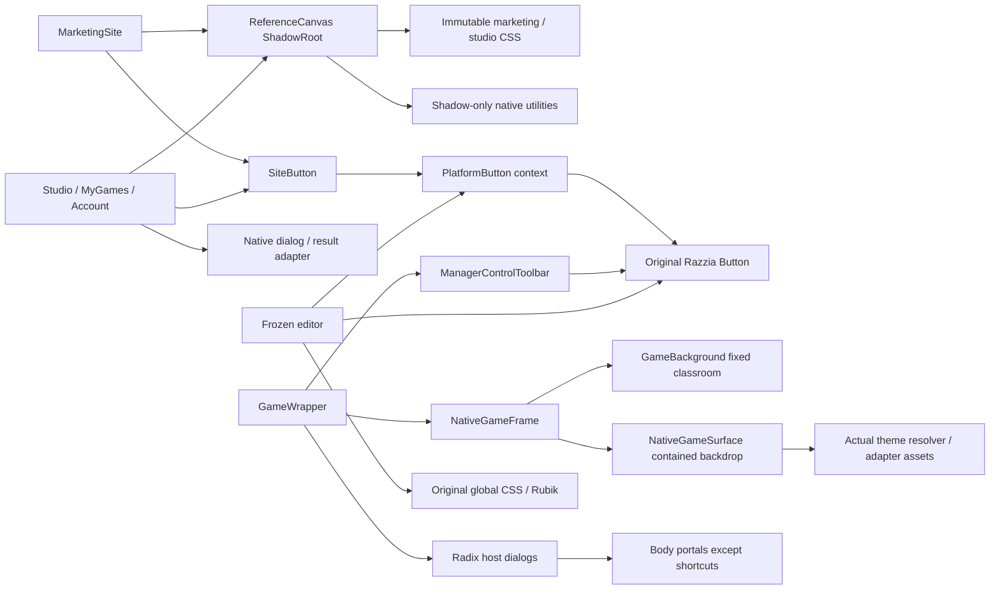
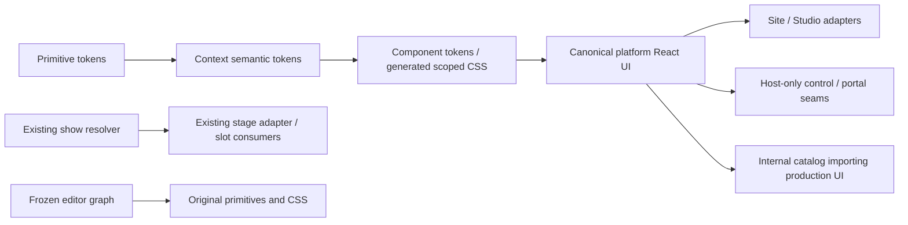

# TDS-02 production UI inventory and dependency map

Baseline: `d20a71a8c11d78226eba7f30cb1dcd89c2c550e1`, inherited product source
`fb6c7631999f`. Generated [327-file inventory](tds-inventory.json) contains exact
paths/hashes, imported modules, CSS-variable names, animation source anchors,
classification, owner and migration destination. Regenerate with
`node extensions/qa/tds-inventory.mjs`. Imports are lexical (including dynamic
imports), not compiler-resolved transitive dependencies. Binary assets are
inventoried from the actual manifests; a declared preset is not runtime evidence.

| Classification            | Count | Decision                                                                       |
| ------------------------- | ----: | ------------------------------------------------------------------------------ |
| canonical                 |    40 | Existing site features/adapters and actual show contracts retain ownership     |
| reuse-with-wrapper        |    27 | Upstream controls and site adapters; platform wrappers only                    |
| legacy-compatibility-only |     2 | Original PlatformControlsProvider/native-button map; preserve editor consumers |
| editor-protected          |    77 | No edits, moves, imports or style migration                                    |
| replace-presentation-only |    69 | Host/package/view candidates; protected paths require exact approval           |
| not-in-scope              |   112 | Cinematic/audio/WAAPI/Lottie and historical QA; reuse regression coverage      |

These are ownership dispositions, not a claim that all 69 candidates need edits.
Only the proven small seams in [the proposal](TDS_UPSTREAM_SEAMS.md) are candidates.

## Screen → production component → current token/style dependencies

| Screen                          | Actual component(s)                                                                                          | Current styling and migration owner                                                                                  |
| ------------------------------- | ------------------------------------------------------------------------------------------------------------ | -------------------------------------------------------------------------------------------------------------------- |
| Home/catalog/demo/pricing       | `site/web/marketing/{MarketingSite,Catalogue,Pricing}.tsx`, source beam/border components                    | `site-assets/marketing.css`, `site/themes/corrections.ts`, ShadowRoot native utilities; platform marketing scope     |
| Login/signup/verification/reset | `site/web/account/AccountGateway.tsx` and current account adapter                                            | `site/themes/account.ts`, ReferenceCanvas; same auth/session endpoints, platform marketing scope                     |
| Studio/navigation/loading       | `site/web/studio/{Studio,StudioLoading}.tsx`, `shared/SiteLoading.tsx`                                       | `site-assets/studio.css`, `themes/studio.ts`, scoped native utility layer; platform Studio scope                     |
| My Games gallery/list           | `site/web/studio/MyGames.tsx`, existing `use-show-file-actions`/`ShowImportModal`                            | ReferenceCanvas + studioStyle; platform cards/buttons/menu, existing import/API handlers                             |
| Account/licenses/events/prepare | `site/web/studio/{AccountPanel,Events}.tsx`                                                                  | Studio scope; real queries/account keys, existing billing configuration and room creation                            |
| Private packages                | `site/web/studio/PackageTools.tsx` → unchanged `features/manager/components/packages/PackageManager.tsx`     | `site/themes/packages.ts` plus native utility CSS; retain validation/tenant/installer state                          |
| Native host shell               | `features/game/components/GameWrapper.tsx` → `tadazz-show/NativeGameLayout.tsx`                              | Upstream global CSS/orange controls + contained themed surface; targeted host scope and viewport backdrop seam       |
| Host toolbar                    | `ManagerControlToolbar.tsx`, `RoomLockButton.tsx`, `legacy-stage-elements.tsx`                               | Repeated Button classes, opaque black/white/orange styles; canonical wrappers after approval, handlers untouched     |
| Host dialogs                    | `HostShortcutsDialog.tsx`, `HistoryDialog.tsx`, `HostPlayersModal.tsx`, `GameSettingsModal/index.tsx`        | Radix portals; native global tokens; platform portal/surface wrappers after approval                                 |
| Lobby join                      | `states/Room.tsx`, `tadazz-show/TadazzScreens.tsx`, `presentation/tadazz-v4/reference-story/SeatingPlan.tsx` | Multiple layouts; consolidate safe data only, preserve Creating Worlds choreography/seating                          |
| Audience / projected host       | `tadazz-show/TadazzShowView.tsx`, `NativePublicContent.tsx` → trusted stage adapter                          | Actual show manifest palette/slot precedence; no platform UI typography on stage, no manager controls on public view |
| Content editor                  | `features/quizz/**`, `extensions/src/editor/**`, original component/provider graph                           | Frozen original global/native tokens and Rubik; zero migration                                                       |

All paths in this table are rooted under `extensions/src/` or `packages/web/src/`
as indicated by the generated full paths. Data adapters remain canonical: no new
room/account/roster authority, API or credential store is introduced.

## Duplicates, boundaries and verified findings

- **Buttons:** original Razzia Button, extension PlatformButton port, site
  SiteButton adapter, native `<button>`/anchors and repeated host Button classes.
  New platform UI gets one owned API. The original shared port stays intact
  because it is also an editor/presentation dependency. Anchors retain link
  semantics; migrate their appearance with shared button styles, not fake clicks.
- **Dialogs:** native `<dialog>` in site shared/Dialog, Radix host dialogs,
  Radix AlertDialog confirmations, QR AlertDialogs, package preflight inline
  section. Share platform surface/portal primitives and focus behavior; do not
  recreate server state or force all content into one god component.
- **Site scope:** ReferenceCanvas creates an open ShadowRoot, imports only native
  utility/theme CSS (no Tailwind preflight), and temporarily releases the existing
  body's `touch-action` restriction with cleanup. Keep the restoration on exit.
  `studio.ts` has wildcard/button/summary rules, but they are currently confined
  inside the ShadowRoot. Never import these strings into the document or editor.
- **Portal scope:** Select, Combobox, Tooltip, AlertDialog and host settings,
  roster/history portal to body; shortcuts alone explicitly target
  `document.fullscreenElement`. A z-index increase cannot move a body portal into
  the fullscreen top layer. Platform portal scope must carry its token CSS into
  either the ShadowRoot target or fullscreen container. Nested menus must remain
  inside focus ownership. Avoid global Radix skin overrides.
- **Background:** NativeGameFrame provides metadata/context but no themed
  viewport backdrop. GameWrapper always mounts GameBackground; only its middle
  NativeGameSurface uses `themeAdapterAsset(..., "questionBackdrop")`. Screenshot
  `before/host-join.png` proves classroom above/below stage. A fixed Classic-only
  CSS override would break selected theme/custom-media fallback semantics.
- **Join:** native Room uses live invite code and `/game?pin=...`, existing lock
  state and manager-authorized kick; cinematic lobby has its own QR and selected
  dial-in/seating props. Share a typed, role-safe contract; never copy participant
  phone values into it. Standby precedes explicit launch and is not a join screen.
- **My Games:** only metadata `{id, subject}` is available in the actual API
  adapter. Keep an explicit fallback cover; do not fabricate per-game metadata.
  List CSS sets `aspect-ratio:auto` with a stretched flex child; use a 16:9 cover
  box with bounded width/height. The always-present Create tile duplicates the
  top primary CTA. Duplicate/Export/Delete are spread across the row. Package
  management is currently an always-expanded inline section, not a modal.
- **Roster:** status/counts come from server hostPresence. Phone Invite Only is
  laid out as a fifth stat tile. Removal at HostPlayersModal:845 immediately
  invokes `handleRemove`, without confirmation. Table scroll already exists;
  evaluate 400 rows before adding a virtualization dependency. Do not invent
  participant presence or use the roster's private phone values on public stage.
- **Account:** real disabled/configured billing state and password reset already
  work. Preserve them; improve hierarchy/spacing only. Existing sidebar account
  links can be visually consolidated without removing account access.
- **Naming:** shared product constant currently says `TADAZZ!`, but changing it
  globally would affect frozen/editor consumers. Platform copy must be scoped.

## Actual motion implementation versus declarations

| Owner                   | Actual source/evidence                                                                                                                     | Decision                                                                   |
| ----------------------- | ------------------------------------------------------------------------------------------------------------------------------------------ | -------------------------------------------------------------------------- |
| Marketing decorative UI | `site/components/AnimatedShinyText.tsx`, `MagicBorderBeam.tsx`, `MagicConfetti.tsx`, `themes/corrections.ts`                               | Retain artwork/identity; map reusable UI timings to semantic tokens        |
| Loading                 | `site/themes/studio.ts` `@keyframes site-skeleton`, reduced-motion branch                                                                  | Canonical pending state; keep accessible status text and reduced motion    |
| Host/dialog UI          | Existing Radix `animate-fade` and Button transitions                                                                                       | New bounded platform motion tokens, no timing authority changes            |
| Leaderboard UI          | `features/game/components/states/Leaderboard.tsx`: Motion AnimatePresence, `layout`, `useSpring`                                           | Source pattern only; do not import orange styling or change scored results |
| Editor ordering         | Frozen dnd-kit imports under `features/quizz/**`                                                                                           | Editor-protected, no new DnD/motion migration                              |
| Cinematic choreography  | `presentation/tadazz-v4/motion.ts`: actual WAAPI `.animate` calls and cancellation/pause logic; `tadazz-show/motion-engine.ts`, source CSS | Outside platform UI motion; preserve keyframes/durations/identity          |
| Media/audio             | Lottie player and actual manifest assets; AudioCuePlayer and existing timing/cue owners                                                    | No new assets inferred from preset names; no duplicate audio/motion owner  |
| Theme manifests         | Classic 31 assets / Razzia 36 assets, actual IDs/adapter asset references in inventory                                                     | Keep persisted renderer IDs, hashes/provenance, role/slot precedence       |

## Canonical destination and dependency direction

`extensions/src/platform-ui/` will own versioned token definitions, generated
scoped CSS, platform-only typed React wrappers, portal targeting and UI motion.
Public barrels/export path keep consumers out of internal file layout.
Contexts: `platform.marketing`, `platform.studio`, `platform.host`; `show.theme`
remains the current resolver, and `editor.current` is documentation only.

No edge from the new platform library to frozen editor code. No new platform
tokens override `--show-theme-*`, original `--color-primary`, root typography,
global preflight or document body. Host theme providers can carry context without
styling stage content; only platform control/surface wrappers consume UI styles.

## Validation and next action

PASS: inventory generation (327 records, exact six classifications, real manifest
asset counts); protected-source guard (602 hashes); `git diff --check`.
The visual findings link to the verified TDS-00 before captures. No runtime
source changed in TDS-02, no production/controller/schema/PII edits.
Next: TDS-03 tokens and bounded scopes, then components/catalog/site phases.
Protected host changes remain proposed, not authorized. The exact approval
boundary is recorded separately so authorized downstream work can continue.
